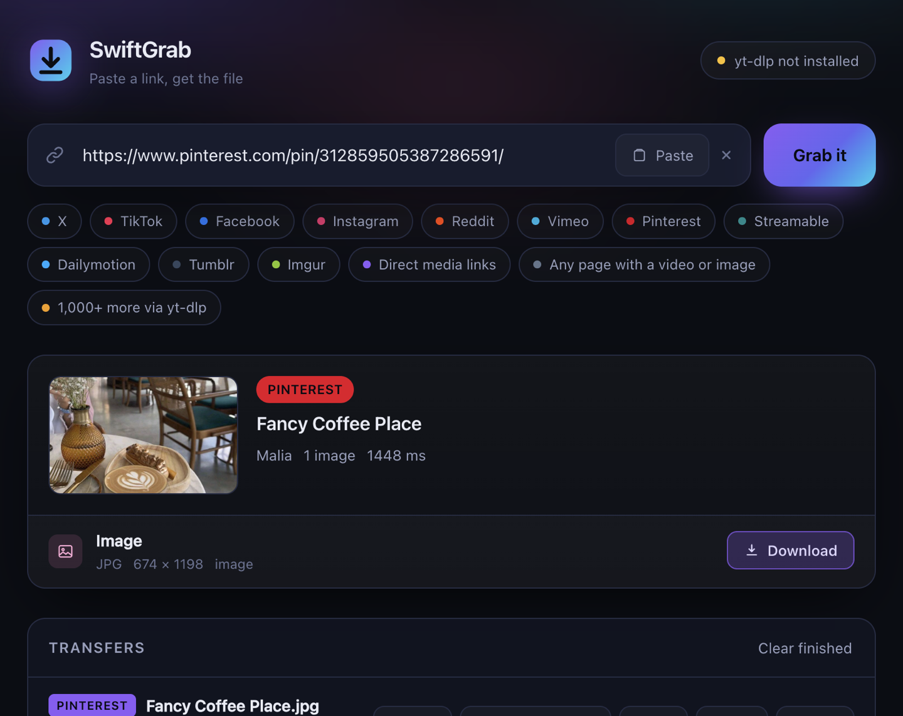

# SwiftGrab

Paste a link, get the video or image.



SwiftGrab is a small local web app: a Node HTTP server plus a browser page. You
drop in a link from X, TikTok, Facebook, Instagram, Reddit, Vimeo, Pinterest and
plenty of others, pick a quality, and watch it land in `downloads/`. It handles
pictures as well as video.

It has **no dependencies at all** - no `npm install`, no build step, no
Homebrew. Just Node.

```
node server.js
```

That starts the server on <http://127.0.0.1:8787> and opens your browser.

---

## Running it

```
node server.js                 # port 8787, opens your browser
node server.js --port 9000     # a different port
node server.js --lan           # bind 0.0.0.0 so your phone can use it
node server.js --no-open       # do not open a browser
node server.js --allow-private # let it fetch localhost/private addresses
```

`npm start` and `npm run lan` are shorthand for the first two.

It binds to `127.0.0.1` by default, so nothing on your network can reach it
unless you pass `--lan`. See [Security](#security) before you do.

Downloads land in `downloads/` next to `server.js`. The library panel in the UI
lists them, can preview them in a tab, and can delete them.

**Requirements:** Node 18 or newer (developed and tested on Node 24). Nothing
else.

## Deploying it

On **Render**, SwiftGrab detects `RENDER=true` and binds to `0.0.0.0`
automatically, using the `PORT` that Render assigns. The default `npm start`
works as-is; an explicit equivalent is:

```
node server.js --lan --no-open      # or: npm run start:render
```

On another platform, set `SWIFTGRAB_HOST=0.0.0.0` (or pass `--lan`) and make
sure the platform's `PORT` is honoured.

Two things to know about running it in a container:

- The filesystem is ephemeral. Downloads and the optional yt-dlp binary are
  written under the app directory and disappear on redeploy or restart.
- The app has no login. A public URL is a public downloader — see
  [Security](#security) first.

---

## What it handles

**Native extractors** - SwiftGrab reads these sites itself, so there is nothing
extra to install:

| Source | How it works |
| --- | --- |
| **X / Twitter** | The syndication payload behind embedded tweets, via the FxTwitter mirror with X's own CDN as fallback. Every MP4 quality on offer. |
| **TikTok** | The hydration JSON inside the post page. |
| **Facebook** | The page's own video JSON and, where present, an HLS stream. |
| **Instagram** | The post's shared data block. |
| **Reddit** | The public post JSON where reachable, otherwise oEmbed for metadata. See [Reddit](#reddit-is-the-awkward-one). |
| **Vimeo** | The config block on the player page. |
| **Pinterest** | The pin's own JSON (initial state and relay responses): image pins return the original picture, video pins return the MP4. |
| **Streamable, Dailymotion, Tumblr, Imgur** | Each site's own API or page data. |
| **Any direct media link** | A URL that already points at an `.mp4`/`.m3u8`/`.webm`/`.jpg`/`.png` etc. is fetched straight. Extensionless CDN URLs are probed for their content type. |
| **Any page with a video or image** | Fallback scraper: finds `<video>`, `<source>` and `<audio>` tags, OpenGraph video tags, and JSON-LD. If there is no video, it falls back to the page's `og:image` / `twitter:image` / JSON-LD image. |

Pictures use the same queue as videos: direct image URLs, Pinterest image pins,
and the main image of an ordinary page. Video is always tried first, so a page
that has both returns the video; the image is the fallback.

**yt-dlp fallback** - for everything else. YouTube, Twitch, SoundCloud,
Bilibili, Rumble and about a thousand more. One click to install, no Homebrew
and no Python required: SwiftGrab downloads the standalone `yt-dlp_macos`
binary into `./tools/`. The UI offers this automatically when you paste a link
it recognises but cannot fetch itself.

`ffmpeg` is optional and stays optional. Without it, yt-dlp can still fetch
anything already muxed, but it cannot merge a separate video and audio track.
SwiftGrab reports that honestly in the variant list instead of pretending
everything is fine.

---

## How a download is chosen

For each link SwiftGrab lists the video, image and audio variants it actually
found, and picks the engine that can fetch each one:

- **direct** - a plain HTTP GET of a progressive file, with range-resume and
  retries.
- **hls** - SwiftGrab's own HLS assembler. Many sites only publish adaptive
  streams, which a plain GET cannot fetch; this walks the playlist, downloads
  the init segment and every media segment, and concatenates them into one
  playable file.
- **yt-dlp** - handed to the binary, for anything needing a real muxer or a
  site-specific fix.

Progress, speed, ETA, cancel and resume are handled by the same queue for all
three. Three downloads run at a time.

### DRM: we trust the bytes, not the label

A playlist saying `#EXT-X-KEY` does not prove a stream is encrypted, and a
missing tag does not prove it is clean. So SwiftGrab reads the actual container:
it parses the HLS init segment's `moov` box and looks for the CENC boxes that
mean real encryption (`pssh`, `sinf`, `tenc`, `senc`).

If the bytes are encrypted, or the stream splits audio into a separate rendition
that only a muxer could rejoin, SwiftGrab refuses and says so rather than
quietly saving a file that will not play.

---

## Security

SwiftGrab fetches URLs that a user pastes, which is a gift to anyone who can
reach it. So:

- **SSRF guard.** Loopback, private (10/8, 192.168/16, …), link-local and cloud
  metadata addresses are refused - and re-checked on **every redirect hop**, so
  a public URL cannot bounce the server into its own network. `--allow-private`
  turns this off, for when you deliberately want to grab something on your LAN.
- **Bound to localhost by default.** Use `--lan` only on a network you trust:
  the server has no authentication. The exception is a hosted platform such as
  Render, where binding `0.0.0.0` is the only way to receive traffic.
- Static file serving is path-confined, and the library/reveal endpoints clamp
  every path to the downloads folder.

If you expose this on a network you do not control, put authentication in front
of it first.

---

## Reddit is the awkward one

Reddit is the site most likely to disappoint, and it is worth knowing why.
Measured from the network this was built on:

| Endpoint | Result |
| --- | --- |
| Anonymous `.json` API | `403` with a block page |
| `old.reddit.com` | redirects to a login wall |
| `embed.reddit.com` | serves the client-rendered shell - HTML contains a thumbnail and no media, because the player fetches its source from `/svc/shreddit/graphql` at runtime |
| RSS (listing or single post) | works, but rate-limits to `429` after a couple of requests, and carries metadata only |
| **oEmbed** | **works** - the one reliable metadata source |

oEmbed is picky in a way that is easy to miss: it **rejects** the shorthand
`/comments/<id>/` form with `400 invalid URL value` and only accepts a full
permalink with the subreddit in it. SwiftGrab preserves the subreddit from the
link you paste, which is what makes the metadata path work at all.

The upshot: SwiftGrab usually gets you the real title and author, and when it
cannot reach the media it tells you the post needs yt-dlp instead of failing
with a mystery 404. Reddit also stores video and audio as separate tracks, so
the progressive MP4 is silent by design - the yt-dlp entry is the one that
produces a single file with sound.

---

## Tests

```
npm test                  # offline: parsers, guard, queue, and a real download
node test/run.js --live   # also hits the real sites
```

The offline suite runs against HTML and playlists captured from the real sites,
so a broken regex fails the build. It also downloads a real MP4 and a real JPEG
through the queue and checks the bytes and content types. The live suite
confirms the extractors still understand today's pages, and skips (rather than
fails) when a site blocks or rate-limits the request.

---

## Copyright

SwiftGrab is a downloader. It has no opinion about what you point it at, and no
ability to give you permission for it either. Downloading video or images may
breach a site's terms of service or someone's copyright, and that is on you. Use
it for things you have the right to save - your own uploads, openly licensed
material, or content whose terms allow it.

SwiftGrab deliberately ships without login or cookie support, so it only ever
sees what a logged-out visitor sees.

## Licence

MIT - see [LICENSE](LICENSE).
